<picture>
  <source media="(prefers-color-scheme: dark)" srcset="assets/banner-dark.svg">
  
</picture>

<h1 align="center">Hey, I'm Mayeen. Welcome to my den.</h1>

  <strong>Senior Software QA Engineer · Builder · Bug detective</strong> 
  Turning “works on my machine” into “here's the evidence.”

  <a href="https://mayeensajid.netlify.app">↗ Portfolio</a> &nbsp; · &nbsp;
  <a href="https://www.linkedin.com/in/mayeen-abedin-sajid-50b4a0194/">↗ Say hello</a> &nbsp; · &nbsp;
  <a href="#inside-the-den">↓ Wander around</a>

<picture>
  <source media="(prefers-color-scheme: dark)" srcset="assets/desk-notes-dark.svg">
  
</picture>

📓 Pause here. Borrow a thought.

> A passing test answers a question. Curiosity asks a better one.
>
> Make room for the strange idea. Then build a way to test it.
>
> Leave the code clearer, the product kinder, and the next person a clue.

## Professional Snapshot

**Senior Software QA Engineer (L1) · Enosis Solutions · Dhaka** 
Nearly 4 years of asking “what could go wrong?” — and coming back with evidence.

- **Own the release.** QA POC for an enterprise platform migration, from test strategy through staging acceptance and release sign-off.
- **Engineer the checks.** Playwright + C#/NUnit at work; TypeScript UI and API automation in my portfolio.
- **Show the receipts.** GroceryMate audit: **9 defects · 4 viewports · every High/Medium fix independently re-verified.**

## Inside the Den

*Six little rabbit holes. Click a card. Peek inside. Stay curious.*

<picture><source media="(prefers-color-scheme: dark)" srcset="assets/card-museum-dark.svg"></picture>

**I collect bugs with backstories.** Real failure patterns, root causes, and ways to catch them.

First exhibit: a refresh-token race hiding behind “random logouts.”

[Enter the museum →](https://github.com/Mayeen4536/bug-museum)

<picture><source media="(prefers-color-scheme: dark)" srcset="assets/card-playwright-dark.svg"></picture>

**Tests with receipts.** Playwright + TypeScript, reusable auth, UI journeys, and API contracts. Failures leave traces.

[Lift the lid →](https://github.com/Mayeen4536/playwright-saucedemo-automation) · [Check the real CI →](https://github.com/Mayeen4536/playwright-saucedemo-automation/actions)

<picture><source media="(prefers-color-scheme: dark)" srcset="assets/card-grocery-dark.svg"></picture>

**Fair shares. Unfairly thorough testing.** A household-expense app audited across **88 interaction steps · 4 viewports · 9 defects found**.

Every High and Medium issue fixed and independently re-verified in that audit.

[See the fieldwork →](https://github.com/Mayeen4536/GroceryMate)

<picture><source media="(prefers-color-scheme: dark)" srcset="assets/card-toolkit-dark.svg"></picture>

**At work:** Playwright · C# · NUnit 
**In the den:** TypeScript · API testing · SQL · GitHub Actions

My favorite tool? **A suspiciously specific question.**

<picture><source media="(prefers-color-scheme: dark)" srcset="assets/card-now-dark.svg"></picture>

**More museum exhibits. Smarter test design. A path toward SDET.**

Exploring AI-assisted QA, with a human checking the answers. Leaving small improvements upstream, too: [a merged fix in Python's icalendar →](https://github.com/collective/icalendar/pull/1736)

<picture><source media="(prefers-color-scheme: dark)" srcset="assets/card-play-dark.svg"></picture>

**🍪 The case of the impossible cookie**

One cookie left. Mina and Rafi each click **Buy** once. Both get an order confirmation. Stock now says **0**.

<picture>
  <source media="(prefers-color-scheme: dark)" srcset="assets/cookie-case-dark.svg">
  
</picture>

**How did one cookie sell twice?** Tap your theory.

🖱️ Someone double-clicked Buy.

Good first suspect. But the clue says **two different shoppers, one click each**. This bug doesn't need a double-click. Try another theory.

🧾 One order printed two receipts.

That would explain duplicate paper. The order log shows **two different order IDs**, though. Something happened before the receipts.

⚡ Both shoppers claimed the same last cookie.

**Caught it. A race condition wearing a cookie costume.**

Both checkouts read “1 left” before either reserved it. Each accepted an order and wrote “0 left.” Two promises. One cookie.

**My next move:** reserve stock atomically, then run two checkouts together. Expect **one confirmation and one sold-out response**.

`Case cracked. Cookie custody: still disputed.`

[More bugs with backstories →](https://github.com/Mayeen4536/bug-museum)

---

  <strong>A strange idea? A tricky bug? Pull up a chair.</strong> 
  Open to Senior QA, QA Automation, and SDET roles.  
  <a href="https://www.linkedin.com/in/mayeen-abedin-sajid-50b4a0194/">Let's talk ↗</a> &nbsp; · &nbsp;
  <a href="https://mayeensajid.netlify.app">Visit my portfolio ↗</a>  
  Leave with a question. Come back with an idea.

